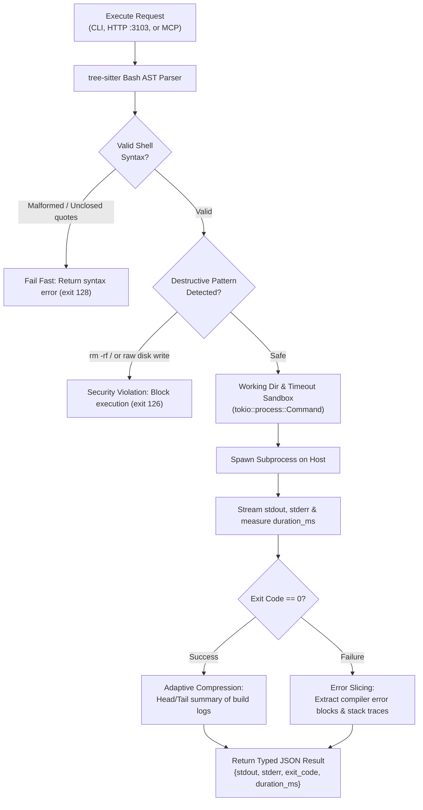

# agent-muscle — Deep Operational & Architectural Context for Agents

> **Execution Runtime & Sandboxing Actuator** — In-depth architectural guide, execution mechanics, AST safety parsing, CLI reference, HTTP/MCP contracts, and failure recovery runbooks for `agent-muscle`.  
> **Ecosystem Version Baseline:** `v1.0.0-beta.3`  
> **Documentation Hub:** [https://autonomic-ai.dev/docs/execution](https://autonomic-ai.dev/docs/execution) · [Architecture Hub](https://autonomic-ai.dev/docs/architecture)  
> **Port:** HTTP API `:3103`  
> **Default Workspace & State:** `~/.autonomic/muscle/` · `~/.autonomic/state/muscle/`

---

## 1. Executive Summary & Biological Role

In the Autonomic 11-organ architecture, **`agent-muscle`** serves as the **Physical Actuator and Container Runtime Interface (CRI)** (analogous to the `kubelet` or system execution engine).

Traditional AI agent frameworks force LLMs to write complex Python subshells, concatenate unescaped shell strings, and manually parse raw terminal streams. This introduces severe vulnerabilities:
1. **The "JSON Tax":** Language models waste significant token capacity synthesizing boilerplate syntax and error handlers.
2. **Syntax Crashes & Broken Escapes:** Minor quote or pipe errors crash entire task loops before execution even begins.
3. **Catastrophic Shell Commands:** Unguarded agents can execute recursive deletions (`rm -rf /`), overwrite partitions, or spawn fork bombs.
4. **Context Window Flooding:** A single `cargo build` or `npm test` producing 5,000 lines of compiler logs overflows context windows, degrading the agent's reasoning.

`agent-muscle` solves these failure modes by completely decoupling cognitive reasoning from physical execution:
- The LLM emits a compact, structured execution request.
- `agent-muscle` intercepts the command, performs in-memory **AST syntax and security analysis**, executes the process within a sandboxed environment, and returns an adaptively compressed JSON payload.

---

## 2. Core Architecture & Execution Mechanics



### 2.1 Pre-Execution AST Syntax & Safety Interception
Before spawning any subshell (`sh -c`), `agent-muscle` evaluates commands using in-memory `tree-sitter` bash AST analysis:
- **Syntax Validation:** Catches unclosed brackets, unbalanced quotes, and malformed command syntax in memory without wasting OS process table resources.
- **Root & Target Protection:** Blocks destructive operations targeting root or home directories (`rm -rf /`, `rm -rf ~`, `rm -rf $HOME`), direct block device writes (`dd if=/dev/zero of=/dev/sd*`), and unbounded fork bombs.
- **Fail-Fast Error Reporting:** Provides precise line and column diagnostics when syntax is invalid.

### 2.2 Adaptive Output Compression & Failure Slicing
To protect LLM context windows without dropping critical diagnostic information:
- **On Success (`exit 0`):** Compresses repetitive build and compilation outputs, retaining head and tail summaries alongside exit status.
- **On Failure (`exit != 0`):** Automatically isolates compiler errors (`error[E...]`, `TypeError`, `SyntaxError`), stack traces, and failing test assertions with surrounding context lines, while collapsing non-relevant passing logs.

### 2.3 Hardware-Aware ML Training Engine (`/train/run`)
`agent-muscle` includes a native training dispatcher for fine-tuning tasks:
- **Pre-Flight Dataset Validation:** physically validates that `.jsonl` datasets conform to Alpaca or ShareGPT format before scheduling hardware resources.
- **Apple Silicon Acceleration:** Automatically leverages **MLX** on macOS M-series systems for high-throughput, low-power unified memory LoRA training.
- **Linux & CUDA Acceleration:** Falls back to **Candle** or PyTorch backends on Linux/x86 architectures, automatically assigning GPU devices.

---

## 3. Complete CLI Command Reference & Flags

`agent-muscle` provides a single native binary for daemon mode, synchronous execution, training jobs, and system diagnostics:

### 3.1 Synchronous Command Execution
- `agent-muscle run "<COMMAND>"`: Execute a command directly with AST safety analysis and output compression.
  - `--cwd <DIR>`: Working directory for execution (default: current directory).
  - `--timeout <SECS>`: Maximum execution time in seconds before SIGKILL (default: `120`).
  - `--json`: Output full execution results as structured JSON (`{stdout, stderr, exit_code, duration_ms}`).
  - `--raw`: Bypass adaptive compression and stream raw terminal output.

### 3.2 Daemon & HTTP Service
- `agent-muscle serve`: Start the HTTP REST API and NATS JetStream listener.
  - `--port <PORT>`: HTTP API listening port (default: `3103`).
  - `--timeout <SECS>`: Default execution timeout ceiling.
  - `--nats-url <URL>`: NATS broker URL for distributed async compute (default: `nats://127.0.0.1:4222`).
  - `--sandbox <MODE>`: Sandboxing level (`native`, `docker`, or `wasm`).

### 3.3 Training & ML Dispatch
- `agent-muscle train`: Launch a hardware-accelerated fine-tuning run.
  - `--model <ID>`: Base model identifier (e.g. `llama-3.2-1b`, `qwen-2.5-coder-7b`).
  - `--dataset <PATH>`: Absolute path to validated training JSONL file.
  - `--backend <auto|mlx|candle>`: Target training backend.
  - `--epochs <N>`: Number of training epochs (default: `3`).
  - `--lora-rank <N>`: LoRA rank dimension (default: `16`).
  - `--out <DIR>`: Output directory for adapter weights.

### 3.4 Diagnostics & Health Audit
- `agent-muscle doctor`: Audit host environment readiness:
  - Validates `sh` / `bash` shell path and process execution limits.
  - Checks Apple Silicon Metal or NVIDIA CUDA acceleration availability.
  - Verifies NATS message broker reachability.

---

## 4. HTTP & Model Context Protocol (MCP) Contracts

### 4.1 HTTP REST API (`:3103`)

#### `POST /execute`
Request:
```json
{
  "command": "cargo test --test integration",
  "cwd": "/workspace/project",
  "timeout_secs": 60
}
```
Response (`200 OK`):
```json
{
  "stdout": "running 4 tests\ntest test_route ... ok\ntest result: ok. 4 passed; 0 failed",
  "stderr": "",
  "exit_code": 0,
  "duration_ms": 1285,
  "compressed": false
}
```

#### `POST /train/run`
Request:
```json
{
  "model": "qwen-2.5-coder-7b",
  "data": "/workspace/dataset.jsonl",
  "backend": "auto",
  "epochs": 3
}
```

#### `GET /health`
Returns daemon status, active execution count, and hardware capabilities.

---

### 4.2 MCP Tools (via `agent-body serve-mcp` or stdio)

#### `muscle_execute_bash`
- **Description:** Executes a shell command within a monitored, sandboxed environment with AST safety and output compression.
- **Parameters:**
  - `command` (string, required): The shell command line to run.
  - `cwd` (string, optional): Directory where the command will execute.
  - `timeout_secs` (integer, optional): Maximum runtime before termination (default: `120`).
- **Return Object:**
  - `stdout`: Standard output (compressed if long).
  - `stderr`: Standard error stream.
  - `exit_code`: Numeric exit status.
  - `duration_ms`: Execution latency in milliseconds.

#### `muscle_train_lora`
- **Description:** Dispatches a background LoRA fine-tuning run on local hardware.
- **Parameters:**
  - `model_id` (string, required): Base model ID.
  - `dataset_path` (string, required): Path to training JSONL data.
  - `backend` (string, optional): `"auto"`, `"mlx"`, or `"candle"`.

---

## 5. Troubleshooting & Recovery Runbook

### 5.1 Problem: Command Terminated with `exit 124` (Timeout)
- **Cause:** Command exceeded configured execution timeout (default: 120 seconds).
- **Resolution:**
  - Increase timeout limit: `agent-muscle run "cargo build --release" --timeout 300`.
  - For long-running batch jobs, submit via `agent-spine` workflow DAG.

### 5.2 Problem: Command Blocked by AST Safety Guard (`exit 126`)
- **Cause:** Command triggered security heuristics (e.g. recursive deletion on root or home directory).
- **Resolution:**
  - Explicitly qualify local target paths: use `rm -rf ./build` instead of ambiguous expressions.
  - Verify that environment variable expansions do not resolve to empty strings.

### 5.3 Problem: Subprocess Fails with `exit 128` (Syntax Error)
- **Cause:** Unbalanced quotation marks or shell syntax errors caught during AST analysis.
- **Resolution:**
  - Check the error diagnostics returned in `stderr`. Ensure quotes are matched and escape sequences are valid.
